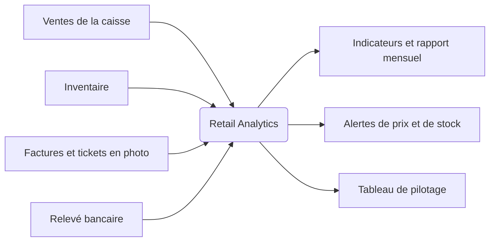

# Retail Analytics

Un outil d'analyse et de pilotage pour un commerce d'alimentation de proximité. Il part des données que le commerce produit déjà (les ventes de la caisse, les factures des fournisseurs, le relevé bancaire) et les transforme en réponses concrètes : quels rayons font la marge, quand un fournisseur augmente ses prix, ce qui va manquer en rayon, ce que le mois a réellement rapporté.

**État : en construction.** Les trois premières versions (v0.1.0 à v0.3.0) sont livrées. Ce qui fonctionne déjà est listé dans [État actuel](#état-actuel). Le reste est décrit dans la [feuille de route](ROADMAP.md).

## Pourquoi ce projet

J'ai tenu un commerce d'alimentation de proximité pendant une dizaine d'années. La caisse enregistre chaque vente, les factures arrivent chaque semaine, la banque envoie son relevé chaque mois. Les données sont là. Ce qui manque, c'est le temps de les croiser.

Résultat : on sait à peu près quels rayons rapportent, on remarque une hausse fournisseur quand elle est grosse, et on découvre en fin d'année ce que le commerce a vraiment gagné.

Même la marge affichée par la caisse est approximative. Elle repose sur un prix d'achat unique par produit, à corriger à la main à chaque changement de tarif, au moment précis où l'ancien stock est écoulé. Sur des centaines de références, personne ne le fait. Ce projet calcule le coût réel de chaque vente à partir des livraisons, lot par lot.

Ce projet part des questions que je me posais en boutique :

- Quels rayons font la marge, et lesquels ne font que du chiffre ?
- Quels produits pèsent vraiment, et lesquels prennent de la place pour rien ?
- Ce fournisseur a changé son prix : promo temporaire ou vraie hausse ? Dois-je changer mon prix de vente ?
- Qu'est-ce qui va manquer en rayon, et qu'est-ce qui dort en réserve ?
- Ce mois-ci, combien le commerce a-t-il réellement gagné ?
- À quelles heures et quels jours il se passe quelque chose ?

## Où va le projet



Le projet avance par phases. Chaque phase ajoute une source de données, et chaque source débloque de nouvelles réponses.

| Phase | Source ajoutée | Ce que l'outil sait faire à la fin de la phase | Versions | État |
|---|---|---|---|---|
| 1. Comprendre les ventes | Exports de caisse | Chiffre d'affaires par rayon et par produit, classement ABC, comparaison mensuelle, analyse par jour et par heure, rapport mensuel | v0.1 à v0.4 | En cours |
| 2. Le stock, les coûts et la marge | Inventaire, factures et tickets d'achat pris en photo | Stock par lots, coût réel de chaque vente (premier entré, premier sorti), marge par rayon, alertes de hausse avec prix de vente suggéré, distinction des promotions, démarque, alertes de rupture | v0.5 à v0.9 | Prévu |
| 3. Piloter les finances | Relevé bancaire, livre de caisse | Tableau de pilotage mensuel : chiffre d'affaires, marge, charges, résultat estimé, trésorerie | v0.10 | Prévu |
| 4. Devenir un produit | Connexion directe à la caisse | Tableau de bord, démo en ligne, ventes récupérées automatiquement | v1.0 à v1.2 | Prévu |

Chaque version est livrable, testée et taguée. Le détail version par version est dans [ROADMAP.md](ROADMAP.md), les changements livrés dans [CHANGELOG.md](CHANGELOG.md).

## État actuel

Dernière version livrée : **v0.3.0, le rapport mensuel**.

- [x] Générateur de données fictives : ventes et journées de caisse de janvier à mi-octobre 2026, au format des exports de la caisse et avec leurs défauts
- [x] Lecture et nettoyage des ventes : doublons entre exports retirés, articles offerts repérés, tickets d'après minuit rattachés à leur journée de caisse
- [x] Contrôles de cohérence au centime entre les lignes, les tickets, les paiements et les journées de caisse
- [x] Rattachement de chaque produit à un rayon, avec la liste des libellés inconnus et la part du chiffre d'affaires non rattachée
- [x] Indicateurs de vente par mois : chiffre d'affaires, tickets, panier moyen pour le magasin et la livraison, encaissements par moyen de paiement, articles offerts
- [x] Détail d'un mois : chiffre d'affaires par rayon comparé au mois précédent, classement ABC des produits, mois incomplets signalés
- [x] Rapport mensuel en une page HTML : chiffres clés et points à retenir, graphiques du chiffre d'affaires par mois, par rayon et des premiers produits, encaissements, articles offerts, fiabilité des données
- [x] Tests automatisés, dont un test qui vérifie que l'outil retrouve les défauts cachés dans le jeu fictif, et intégration continue

### Installation

Avec Python 3.14 :

```
python3 -m venv .venv
source .venv/bin/activate
pip install -r requirements.txt
```

### Utilisation

Générer le jeu fictif dans `data/fictif/` :

```
python -m retail_analytics generer
```

Produire le fichier des ventes propres et catégorisées, avec un résumé et le résultat des contrôles :

```
python -m retail_analytics nettoyer
```

Le fichier `ventes_propres.csv` est écrit à côté des exports. Les montants y sont en centimes.

Sur le jeu complet, un seul contrôle signale un écart : la dernière journée de caisse se termine après minuit, après la fin de l'export. C'est voulu : l'outil le signale au lieu de l'ignorer.

Afficher les indicateurs de vente par mois, puis le détail du dernier mois complet :

```
python -m retail_analytics indicateurs
```

Pour détailler un autre mois, par exemple septembre 2026 :

```
python -m retail_analytics indicateurs --mois 2026-09
```

Produire le rapport du dernier mois complet, en une page HTML :

```
python -m retail_analytics rapport
```

Le fichier `rapport_2026-09.html` est écrit à côté des exports. Il s'ouvre dans un navigateur, et s'imprime en PDF depuis celui-ci. Pour un autre mois, ajouter `--mois 2026-08`.

Lancer les tests :

```
python -m pytest
```

## Données

Les données réelles d'un commerce ne sont jamais publiées. Le dépôt utilise uniquement un jeu de données fictif, produit par un script qui reproduit la structure d'un vrai export de caisse, ses défauts et les phénomènes du métier : saisonnalité par rayon, heures de pointe, jours plus chargés que d'autres. Les promotions et les hausses de prix fournisseurs arriveront avec les achats (v0.6). Les produits, prix et quantités sont inventés.

La stratégie complète est décrite dans [docs/donnees.md](docs/donnees.md).

## Technique

Python, pandas, matplotlib, pytest, GitHub Actions.

## Auteur

Livan, étudiant à 42 Marseille, en reconversion vers le développement et la data après dix ans de commerce.
